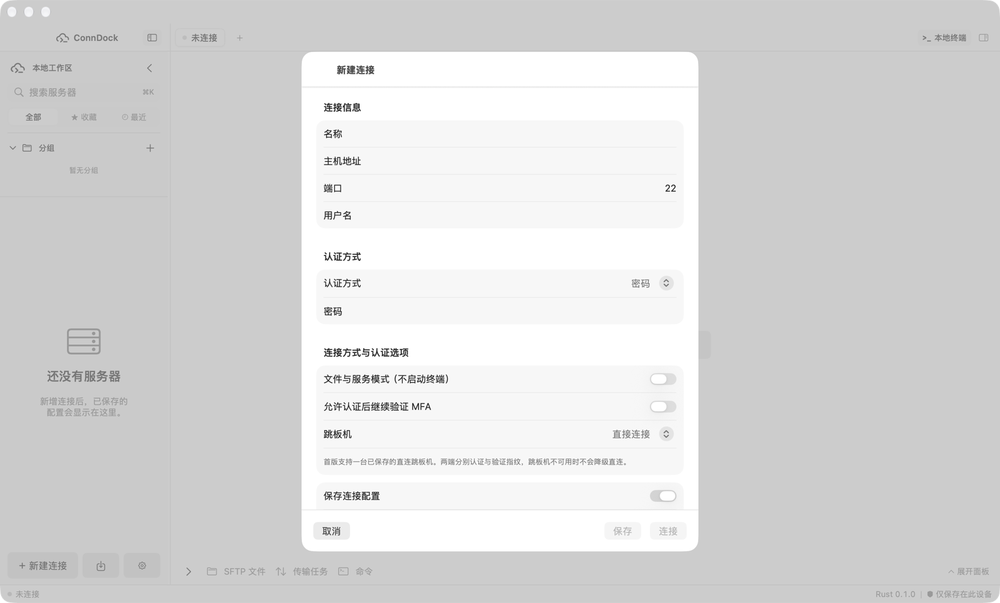
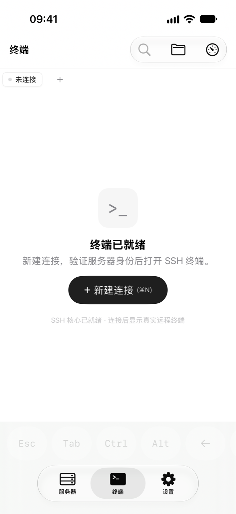
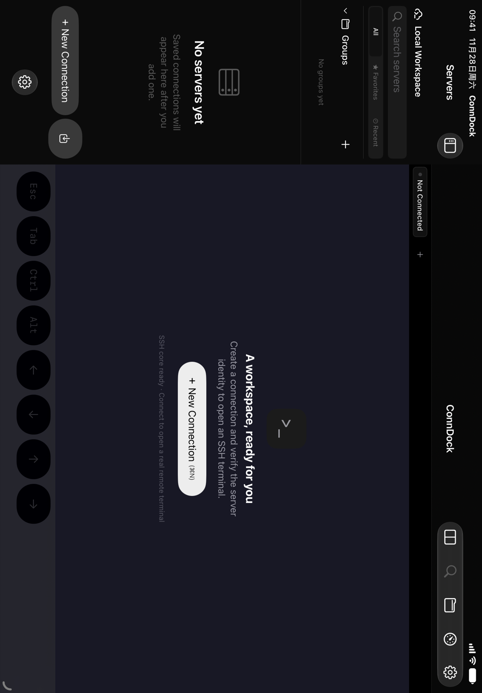

# ConnDock

[简体中文](README.md) · [Download macOS preview](https://github.com/niceyu123/ConnDock/releases)

ConnDock is a native SSH client for Mac, iPhone, and iPad. It brings SSH terminals, SFTP transfers, and Linux resource monitoring into one workspace.

## Download

Get the macOS ZIP from [GitHub Releases](https://github.com/niceyu123/ConnDock/releases). The preview requires an **Apple silicon Mac (arm64)** running macOS 14 or later. It is locally signed, has not been notarized by Apple, and runs with iCloud sync disabled. Build the iPhone and iPad apps from source using Xcode.

## Screenshots



| iPhone | iPad |
| --- | --- |
|  |  |

## Features

- Organize saved hosts with groups, tags, favorites, recent connections, and OpenSSH Config import.
- Use multiple SSH terminal tabs and split panes, search the current pane's scrollback, and choose terminal fonts and themes.
- Connect using passwords or supported OpenSSH keys. Single-hop jump hosts and keyboard-interactive authentication support common MFA flows.
- Browse and transfer files with SFTP. File and Services mode opens an authenticated connection without requesting a terminal.
- View CPU, memory, disk, and network metrics on supported Linux hosts.
- Export and import encrypted configuration backups. SSH credentials you choose to save are stored in the device Keychain. See the [backup guide](docs/CONFIGURATION-BACKUP.md) and [privacy notes](docs/PHASE6-PRIVACY.md).
- Switch between Simplified Chinese and English and choose system, light, or dark appearance.

## Build from source

Requirements include macOS 14 or later on Apple silicon, full Xcode with Swift 6, Rustup, and XcodeGen. The iPhone and iPad app targets iOS/iPadOS 17 or later.

```sh
brew install xcodegen
xcodebuild -downloadComponent MetalToolchain
./scripts/build-xcframework.sh
xcodegen generate --spec apple/project.yml
open apple/ConnDock.xcodeproj
```

Select `ConnDock-macOS` or `ConnDock-iOS`. Use the `Local` configuration for local Mac or simulator development. iPhone and iPad device builds require your own Apple signing setup.

ConnDock uses SwiftUI and SwiftTerm for the native interface, Rust and russh for SSH, and UniFFI for the bridge. See the [architecture](docs/ARCHITECTURE.md) and [Chinese README](README.md) for detailed configuration and verification commands.
