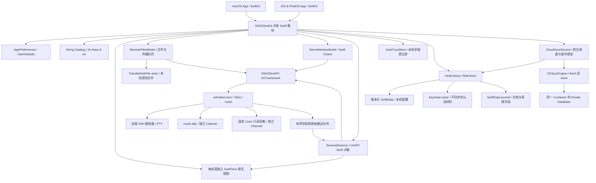

# SSHClient 架构（Phase 5）

需求依据为 [requirements.md](requirements.md)，Phase 4 的 Team/Bundle/Container 与标签范围按用户最新补充。开发名称 SSHClient，最低系统 macOS 14 / iOS/iPadOS 17。Phase 1/2/3 已接通 SSH、主机管理、SFTP 和监控；Phase 4 增加可选的 CloudKit 私有配置同步；Phase 5 接通 macOS MCP，默认关闭。

## Apple 侧

- `SSHClientKit` 是两 App 共用的 Swift Package。所有界面使用 SwiftUI；SwiftTerm 通过 NSViewRepresentable/UIViewRepresentable 嵌入，不使用 WebView。
- `AppPreferences` 在 MainActor 上由 Observation 管理。语言、三态外观、独立终端配色和面板布局分别持久化；缺失/损坏设置回退到可用默认值。这里不存放服务器认证材料。
- `L10n` 从 String Catalog 编译的语言 Bundle 明确取文案，并向 SwiftUI 注入选定 Locale。菜单和原生组件同样使用选定 Bundle 的字符串，避免只改页面、未改 Commands。系统提供的应用菜单与系统权限文案保留平台行为。
- `WorkspacePalette` 分别定义浅色和深色语义颜色；按用户最新反馈采用中性黑白方向，浅色主区域为纯白、深色主区域接近 #090909、终端接近 #050505，用灰阶区分面板。Follow App 在应用或系统外观更新后更新 SwiftTerm 原生属性，不修改终端字节流。
- 设置使用稳定的分类模型：通用、外观、终端、iCloud、安全、关于，以及 macOS 的 AI 工具接入授权与审批页面。Mac 使用分类侧栏与详情，移动端在宽度足够时使用双栏，紧凑宽度使用原生分类列表与详情导航；全部标题复用 String Catalog。
- `HostLibrary` 使用版本化 SwiftData 与显式 ModelContext 保存主机/分组；V2 增加同步 journal/state，V3 以独立扩展表增加标签，保持 V1 主机定义及自动 CloudKit 镜像关闭。主机只持有不可猜测的凭据引用，不持有密码、私钥或口令。编辑用版本检查防止旧表单覆盖新配置；分组删除保留主机，主机删除使用 tombstone。
- `KeychainCredentialStorage` actor 在主线程之外调用系统 Security.framework。macOS 使用本机登录 Keychain，iOS 使用 WhenUnlockedThisDeviceOnly 的应用 Keychain；不启用同步，不回退到明文。新引用写入成功后才提交配置；被替换或删除的引用清理失败时保存非秘密的重试队列。
- `WorkspaceState` 管理标签、独立 `TerminalSession` 和主机信任确认队列。Host UUID、标签 UUID、会话 UUID 分离；每次认证使用不可变目标快照。关闭标签主动断开并释放会话；关闭最后一页恢复起始页。修改目标身份会撤销旧凭据引用，删除主机配置不强制关闭已建立会话。
- 当前 macOS 使用单一主工作窗口及独立设置窗口，iPad 支持窗口尺寸变化但不启用多个 Scene，避免同一 SwiftTerm 原生视图同时被多个窗口持有；多窗口工作区属于后续生命周期扩展，不影响多标签并发连接。
- macOS 分隔条通过轻量 AppKit NSView 接收原生鼠标拖动，并提供键盘和辅助功能增减动作；SwiftUI 管理有界尺寸与本地保存，界面以终端为主。iPhone 使用 TabView + NavigationStack；iPad 使用 NavigationSplitView + 独立工具 Sheet，窄尺寸采用手机式布局。

## Rust 与 FFI

- Cargo Workspace 包含 `sshclient-core`、`sshclient-apple-ffi` 与 macOS `sshclient-mcp`；Apple 库脚本仅构建 FFI，MCP helper 只在 macOS 打包。元数据协议升至 2，`network_enabled: true`；FFI 暴露应用级配置、认证请求、会话对象、状态与稳定错误码，不暴露 russh 类型。
- Tokio 共享两个工作线程。每会话拥有输入通道、合并的 resize、取消信号和 socket shutdown 控制。网络、握手、认证、PTY 等都有期限；人机确认的等待时间独立计时。任何阶段取消或释放 FFI 对象都会关闭底层 socket；满输出队列不阻止最终收尾。
- UniFFI 0.32.2 使用 proc macros 与 library mode；生成代码完全由脚本生成。Swift 每帧非阻塞批取至多约 64 KiB 输出，避免逐字符回调与跨线程 UI 操作。Rust 输出队列 64×32 KiB，输入队列 64×16 KiB，russh channel 缓冲 16 包；Swift 待发送输入至多 256 KiB，SwiftTerm scrollback 5000 行。
- SwiftTerm `send` delegate 传递原始字节；远程输出用 `feed(byteArray:)` 解释 ANSI/UTF-8；尺寸 delegate 进入 Rust `window_change`。视图归属会话，切换标签不丢屏幕。不允许远程 OSC 读取/写入剪贴板、自动打开链接。
- 主机密钥必须验证。未知主机需明确确认，已保存指纹变化不能忽略；本机 `HostTrustStore` 不参与云同步。认证材料仅由内存和用户选择的 Keychain 持有，Rust 自有秘密缓冲使用 Zeroizing；不承诺 Swift String 或第三方库内部副本能逐一清零。
- 按 2026-10-27 用户新要求，macOS 只支持 Apple Silicon（M 系列，arm64）。XCFramework 仅包括 macOS arm64、iOS arm64、iOS Simulator arm64；移除 Intel Rust 目标和 lipo Universal 合并。构建后验证实际 slice 与 App Mach-O 均为 arm64，不能把历史 Intel 编译记录当作当前发布承诺。
- 生成的绑定与二进制不进 Git，首次构建先执行 `build-xcframework.sh`。输入 Cargo.lock、toolchain、UniFFI 配置都受版本管理。

## 后续边界与风险

1. 密码正向验收已在用户提供的真实服务完成，不能用密码禁用的本机 OpenSSH 代替。主机证书/CA、MFA、SSH Agent 和跳板机不在当前支持范围。
2. Phase 2 使用 SwiftData 本地权威主机/分组与 Keychain。正式签名的 Keychain 身份、物理设备、最低系统版本和多窗口生命周期仍需后续验证；ad-hoc macOS 重建后系统可能再次要求授权。
3. Phase 3：russh-sftp 与 Linux 采集使用已认证 Handle 的独立 Channel；无数据、非 Linux、权限不足、超时分别提示。Swift Charts 只展示实际指标。
4. Phase 4：CKSyncEngine 可选同步，SwiftData 不同时自动 CloudKit 镜像；语言/外观不进入同步模型。两端使用真实 Team/Container 配置，但有效签名与真实 iCloud 仍须验收，不能把 Mock 测试当作云端通过。
5. Phase 5：macOS rmcp stdio helper、本地 IPC、逐主机/工具授权和逐操作审批已实现；默认关闭，无 HTTP。正式 Team/App Group 沙盒仍须验收，Local 形态不代替正式签名。
6. SwiftTerm 2.x 与 UniFFI Swift 并发 API 仍有演进；升级时同步生成器、Rust 与 Swift 代码，并重跑三端构建/主题/交互测试。
7. Debug/Release 使用用户提供的 `com.ruohai.termall`、Team `86HC8YA388` 和同一 `iCloud.com.ruohai.termall`；Local 继续使用原开发身份、ad-hoc 签名及无云权限。旧开发沙盒不会自动迁移到正式身份；保留旧数据，不复制活动 SQLite 或导出凭据。真实设备、签名、CloudKit 及 MCP helper 需要对应环境验证。

## 已核查上游

- [SwiftTerm 固定 1.19.0 源码](https://github.com/migueldeicaza/SwiftTerm/tree/v1.19.0)：AppKit/UIKit TerminalView、原生前景/背景色属性与构建插件。
- [UniFFI Swift bindings](https://mozilla.github.io/uniffi-rs/latest/swift/overview.html)：生成 Swift/C header/modulemap、Swift 6 兼容边界；最终以 Cargo.lock 中版本与实际生成物为准。
- [Apple String Catalog](https://developer.apple.com/documentation/xcode/localizing-and-varying-text-with-a-string-catalog)：源目录只维护 `.xcstrings`，由 Xcode 生成本地化资源。

## Phase 3 文件与监控

- `RemoteFilesModel` 持有会话级目录和最多 50 项内存任务，最多同时 2 项传输；Swift actor 负责安全授权的文件句柄，每次最多 64 KiB，经 UniFFI 异步 API 发送给 Rust。Rust 不接受本机路径，不保存文件内容。UI 进度约 100 ms 更新一次。
- `SftpClient` 仅使用已认证且验证主机身份的 Handle；浏览、每个传输与监控均使用独立 Channel。普通取消和句柄 Drop 有关闭保护，未知 Channel 确认由有界 owner 接收并关闭；无法确认时断开传输层，避免未知会话积累。
- Swift Task 取消不等同于取消 UniFFI future，因此打开过程另有显式 `RemoteOperation`；已建立的文件和监控对象也有同步取消信号。取消、隐藏、离开前台与断开按各自资源归属收尾。
- 文件确认绑定原父目录，目录变化时拒绝陈旧操作。删除不递归。上传以独占临时文件写入，最终 rename 提交；替换保留普通权限和 UID/GID，不恢复特殊权限位，不能保留时失败。最终提交禁用主动取消；提交期间断网提示结果不确定。
- 下载流式落盘至应用私有缓存，系统保存/导出窗口在完成后授权目的地；清除任务时释放副本。突然退出可能留下系统可清理的缓存。真实断网也可能留下未提交的远端临时文件，不能承诺跨网络事务回滚。
- `ServerMonitorModel` 在面板可见、连接有效且应用前台时以默认 5 秒周期调用固定 Linux 采集，隐藏、暂停、后台或断开停止。CPU 不重复累加 guest，网络对同名接口做差并处理计数器重置，第一样本不伪造速率，历史最多 120 点。
- Linux 内存读取 MemAvailable，旧系统按可用字段估算；磁盘为根文件系统 `df -Pk /`，不声称展示每一挂载点或 cgroup 配额。任意远程 Shell 执行 API 不在本阶段向外部调用者开放。
- 新增 russh-sftp 3.0.1 的实际 API 已核对 [固定源码](https://docs.rs/russh-sftp/3.0.1/russh_sftp/)；图表使用 [Swift Charts](https://developer.apple.com/documentation/charts)。最终行为以项目测试记录为准。

## Phase 4 同步

- `SyncDocument` 只包含主机非机密配置、分组、标签、逻辑版本与删除标记；大小最多 64 KiB，recordName 只有类型和 UUID。整个文档写入 CKRecord 新的加密 Bytes 字段 `payloadV1`，不使用敏感字段进行云端查询。凭据、信任、会话、最近连接与设备偏好没有编码入口。
- 本地编辑与 journal 入队同一事务。每份记录缓存 CKRecord 系统字段用于并发控制；发送期间再编辑时旧 ACK 只更新系统字段，不清除新版本。获取到的记录先验证再合并，版本使用持久逻辑计数和设备 UUID，不使用设备时钟决定胜负。删除优先，不自动清除 tombstone。
- CloudKit transport 用真实 CKSyncEngine 和 Private Database；默认不实例化 CKContainer，用户在已签名配置下启用后才开始。foreground 调度先检查账号、fetch，再发送；每次运行以 token 隔离，停止后的迟到回调不能写入 token 或本地数据。失败保留 outbox 并退避重试。
- CKSyncEngine 的 `automaticallySync` 为 false，由应用在前台、变更后和周期主动调用，保证启停/账号/Zone 删除边界；未引入后台推送权限或声称后台即时复制。CloudKit 自动重试能力与本地持久队列共同保留未完成变更。
- 两个独立 SwiftData 数据库与 Test Target 内的 MockSyncTransport 验证离线、冲突、删除、账号和取消。CloudKit codec 使用实际 CKRecord 验证加密字段登记/拒绝明文格式。上述检查不替代真实云端签名、Schema、两设备或 Production 验收，步骤见 [PHASE4-CLOUDKIT-SETUP.md](PHASE4-CLOUDKIT-SETUP.md)。

## Phase 5 MCP

- helper 仅依赖 rmcp/序列化/本机 IPC，不链接 SSH、数据库、CloudKit 或 Keychain；主 App 独立负责所有授权、凭据和远程操作。
- 正式 macOS 使用 Team `86HC8YA388` 的专用 group `86HC8YA388.com.ruohai.termall.mcp`，仅存 0700/0600 Unix socket；helper 为独立 sandbox wrapper，不继承外部 Codex 的沙盒。Local 使用 ad-hoc 诊断 helper 和主 App 私有容器，主 App 仍沙盒化。
- 每个请求校验内核 audit token、UID、实际程序路径、封装包和代码签名。六个工具严格参数验证；白名单为空、权限变化/关闭/锁定/取消均拒绝或撤销。任意命令绑定一次性精确参数批准，最多 64 KiB 输出，独立 SSH 连接，不复用终端标签。
- 自动化 Keychain 查询禁止系统认证 UI；目录根必须为真实规范绝对路径。审计只存工具、UUID、时间、结果、耗时和命令摘要，不保存参数/路径/输出/凭据。全部偏好本机保存，不进入同步文档。
- 本机真实 stdio、Codex CLI、隔离 Linux 与 UI 验收已运行。正式签名缺 profile、systemd 成功路径、最低系统/锁屏等未验证项见 [Phase 5 验证](PHASE5-VALIDATION.md)。

## Phase 6 生命周期与发布边界

- iOS/iPadOS 的 `ScenePhase.background` 通知 Workspace 暂停所有会话；`inactive` 不取消 SSH。macOS 普通失焦只影响既有同步调度，不把所有连接当作移动端后台。未完成认证停止，未发送输入清空，SFTP/监控按归属取消。
- 终端恢复使用已验证 SSH Handle 开启并关闭独立 channel，不执行探测命令。Swift 启动事件消费后等待显式可取消 UniFFI operation；只有会话仍存活、状态仍 connected、生命周期代次匹配时才解除输入暂停。失败关闭原连接并走手动重连，不自动获取凭据重试。
- Rust 输入包携带代次。后台/恢复切换更新 watch gate；既丢弃过时排队输入，也用优先取消的 select 丢弃正在等待 SSH 流控窗口的写入。已送到 SSH/网络的字节无法撤回，不承诺远端命令的事务回滚。
- 关闭会话后不再消费迟到 state/output/end 事件；弱引用 polling/native delegate 与明确 close 配合释放 tab。凭据读取跨 await 后必须仍属于有效的应用生命周期和发起标签，不能借用新的选中标签继续连接。
- `PrivacyInfo.xcprivacy` 分别随主 App/helper 打包；系统本地网络用途从唯一 String Catalog 生成两种语言的 `InfoPlist.strings`。关于页读取实际 Bundle 版本/build 与构建类型，bridge 版本独立显示。
- 发行检查只校验已存在的源码/包与本机材料，不修改待检查产物；证书对比仅使用临时提取的公有 DER。Local、未签名编译、内部预检与 Apple 实际接受状态分别报告。Archive/Export 入口只落本地，不上传或修改 Apple 门户；加密分类未完成时发行预检拒绝继续。
- 真实隔离多标签、90 秒 channel 循环与弱引用测试提供有限资源证据；长期 Instruments、物理后台/网络/Keychain、正式 CloudKit/helper 和 TestFlight 验收保留为人工步骤，见 [Phase 6 验收矩阵](PHASE6-ACCEPTANCE.md)。
